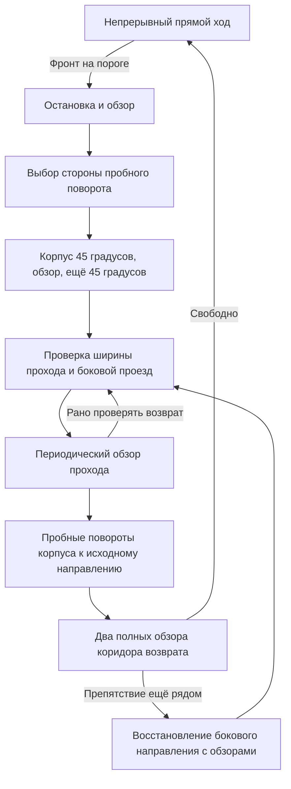

# Почему прежний объезд не сработал и что меняется

## Что подтверждено журналами

Два последних запуска содержат именно версию с непрерывным ходом. Лимиты были 20 и 120 секунд, но оба закончились примерно через 7,5 секунды по решению алгоритма, а не из-за таймера. В обоих случаях причина — `both_sides_blocked`.

| Запуск, по часам Raspberry Pi | Правый крайний луч 45° | Правый ближний луч 81° | Фронт после остановки |
| --- | ---: | ---: | ---: |
| `20260307-155947-969099` | 223,1 см | 16,5 см | 16,4 см |
| `20260307-160214-220611` | 42,6 см | 14,9 см | 14,8 см |

Дата на Raspberry Pi отличается от даты занятия 13 октября; имена каталогов не исправлялись. Видео показывает препятствие перед машиной и место сбоку, но по перспективному изображению нельзя точно определить зазор для всего корпуса.

Прежний алгоритм брал минимум всех лучей справа. Луч 81° продолжал видеть фронтальное препятствие и запрещал поворот, хотя внешний луч 45° смотрел в другой проход. Это ошибочное объединение направлений. Показание 223 см само по себе также не доказывает, что весь проход свободен: одиночный дальний ответ может быть выбросом или отражением от более далёкой поверхности.

Вторая ошибка — ограничение поворота колёс до 18° ради размещения веера возврата внутри поля зрения сервопривода. Небольшой поворот оставляет корпус направленным в сторону препятствия. Для просмотра исходного направления можно временно повернуть корпус, сохраняя механические пределы головки.

Ещё один результат: команда торможения появлялась при 19,5/17,5 см, а неподвижный фронтальный обзор давал 16,4/14,8 см. Это совместимо с дальнейшим продвижением после замера и выбегом. Без синхронного измерения нельзя точно отделить выбег от особенностей ультразвукового отражения. Поэтому 20 см в конфиге — порог команды, а не гарантированная конечная дистанция.

## Выбранная схема

Любой неизвестный обзор, обнаруженная помеха вращению, перекрытый путь или достигнутый предел приводит к остановке. Диаграмма описывает нормальную последовательность, а не все выходы с ошибкой.

Выбор по внешним лучам разрешает только разведочный поворот. После каждого поворота дальномер получает новые измерения; движение не наследует старое разрешение. При почти равных расстояниях выбирается правая сторона, чтобы небольшой шум не менял решение. Существенно более свободная левая сторона имеет приоритет.

Боковой проезд начинается только при оценке курса ±90° к исходному. Диагональная версия была отвергнута после геометрической проверки: она приближала центр машинки к углу пачки, который затем уходил из обзора и мешал обратному вращению. Боковое движение сохраняет исходный продольный отступ от фронтального препятствия. В узком проходе такой способ может потребовать больше места; это допустимая причина остановки.

После четырёх шагов по 0,1 с проверяется проход, после восьми — выполняется проба возврата. Это интервалы наблюдения, а не подтверждение, что препятствие уже пройдено. Если оно ещё мешает, робот восстанавливает прежнее боковое направление; следующая проба выполняется после четырёх шагов, чтобы не уходить слишком далеко. Препятствие впереди на боковом пути запускает досрочную пробу возврата, а не безусловно завершает движение. Общий предел — 30 шагов движения за один объезд, плюс общий таймер запуска.

## Габариты в расчёте

Принцип проверки проходимости по форме корпуса и запасу вокруг препятствий соответствует описанию [footprint в Nav2](https://docs.nav2.org/rolling/configuration_and_development/first_time_robot_setup_guide/footprint/setup_footprint/). Здесь используется собственная небольшая реализация, без ROS и карты.

Для наблюдаемого расстояния `d` на угле головки `a` точка относительно центра корпуса оценивается как:

- `x = sensor_forward_offset_cm + d · cos(90° − a)`;
- `y = d · sin(90° − a)`.

Таким образом учитывается положение излучателей впереди центра машинки, а не только ширина вокруг самого датчика. Свободный фронтальный луч не разрешает движение, если соседняя наблюдаемая точка попадает в коридор корпуса: половина ширины 9,25 см плюс запас 5 см. Перед возвратом проверяется тот же коридор до 30 см от излучателей. Перед вращением наблюдаемые точки должны находиться вне окружности, охватывающей корпус с запасом.

Головка сканирует только 45–135°. Для проверки исходного направления робот поэтапно поворачивает корпус на месте, а затем измеряет весь коридор. Если проход закрыт, поступательного движения на этом направлении не бывает. Физическая оценка курса обновляется только после законченной команды поворота.

## Что проверено и чего проверки не доказывают

Сохранены тесты непрерывного PWM, торможения при отмене/ошибке, таймаутов Echo, безопасных углов и GPIO. Добавлены два настоящих обзора из последних логов как воспроизводимые входные данные. Для них новая логика выбирает правый пробный поворот 45°, не выдавая разрешения на проезд.

Геометрическая симуляция проверяет пересечение прямоугольного корпуса с прямоугольными препятствиями при каждом небольшом перемещении и каждом градусе поворота. Сценарии: пачки шириной 20/30/50 см, один невыпуклый объект, стена справа, проход между двух стен, непроходимый узкий промежуток, протяжённая стена, лучевой и упрощённый конусный дальномер ±5°, выбег 3 см, симметричная ошибка поворота ±5%. Доступные проходы завершаются восстановлением курса; непроходимые постановки дают ограниченную остановку без столкновения в этих моделях.

Это не подтверждение поведения на железе. Реальный ультразвук может видеть пол, иметь пропуски и неточный угол отражения; точка на оси луча — приближение. Между лучами и позади корпуса есть слепые области. Неравные ошибки правого и левого поворотов накапливают ошибку курса, потому что энкодера и IMU здесь нет. Симуляция не воспроизводит все эти эффекты. Не заявляется гарантированный объезд любого невыпуклого объекта или лабиринта.

## Дальнейшее улучшение после этой пробы

1. Проверить обе команды 45° отдельно на размеченной поверхности, измерить угол и разброс нескольких повторов, настроить левую и правую скорости поворота отдельно. Это важнее добавления цвета сейчас.
2. Измерить выбег при PWM 25 и частоту свежих замеров. По результатам можно снижать скорость перед препятствием плавно, не возвращая периодическое торможение.
3. По новым логам проверить, какой именно луч запрещает вращение/проезд. Поправлять геометрию только после сопоставления с измеренным зазором.
4. Проверить назначение, полярность и положение ИК-датчиков. Входы линии под днищем не обеспечивают боковую защиту от пачек; подключать их к остановке как датчики препятствий без проверки нельзя.
5. Для устойчивого курса использовать обратную связь: IMU/энкодеры либо измеренные боковые расстояния до стен. Цветовые классы и датчик напряжения можно добавлять после устойчивого базового объезда. Возврат к стартовой линии движения потребует отдельной оценки положения; эта версия возвращает направление.
